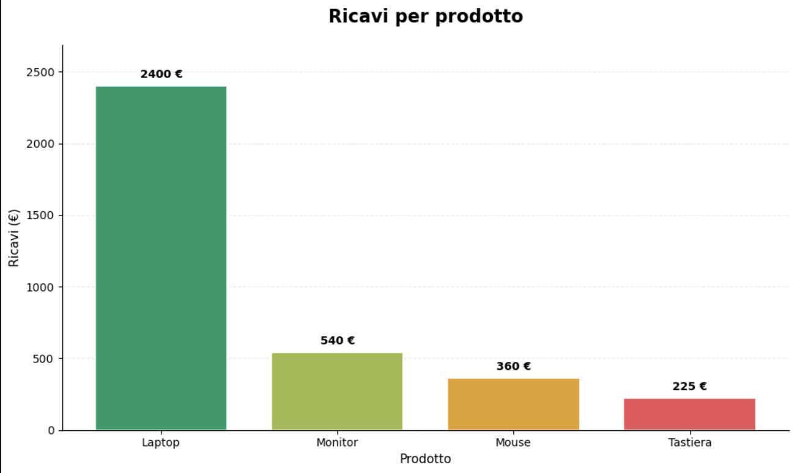
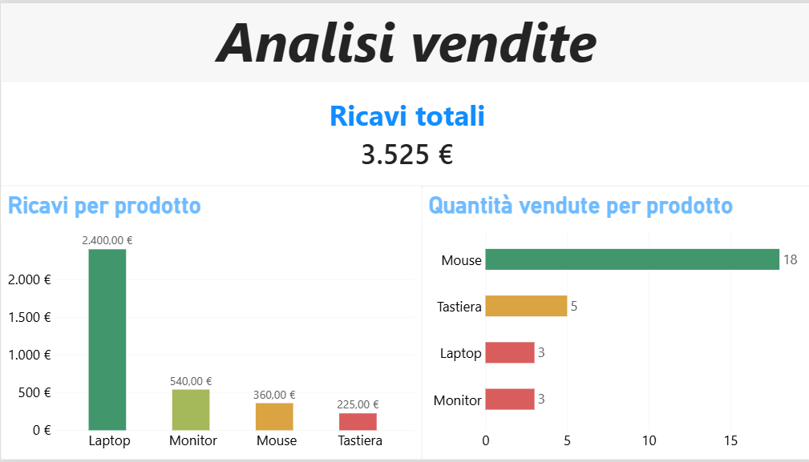

# Analisi vendite — Python e Power BI

## Descrizione

Progetto di analisi di un dataset simulato di vendite con Python e Power BI.

## Strumenti utilizzati

- Python
- Pandas
- Matplotlib
- Power BI
- Git e GitHub

## Obiettivi

- Calcolare i ricavi delle vendite.
- Analizzare i ricavi per prodotto.
- Confrontare le quantità vendute.
- Presentare i risultati con grafici e una dashboard.

## Risultati principali

- Ricavi totali: 3.525 €
- Laptop: 2.400 € di ricavi
- Monitor: 540 € di ricavi
- Mouse: 360 € di ricavi
- Tastiera: 225 € di ricavi
- Prodotto più venduto: Mouse, 18 unità

## Grafico Python

## Dashboard Power BI

## Struttura del progetto

- `data/`: dataset CSV
- `images/`: immagini dei grafici e della dashboard
- `notebooks/`: notebook Python
- `dashboard_vendite.pbix`: report Power BI

## Dataset

Dataset simulato, utilizzato a scopo didattico.
